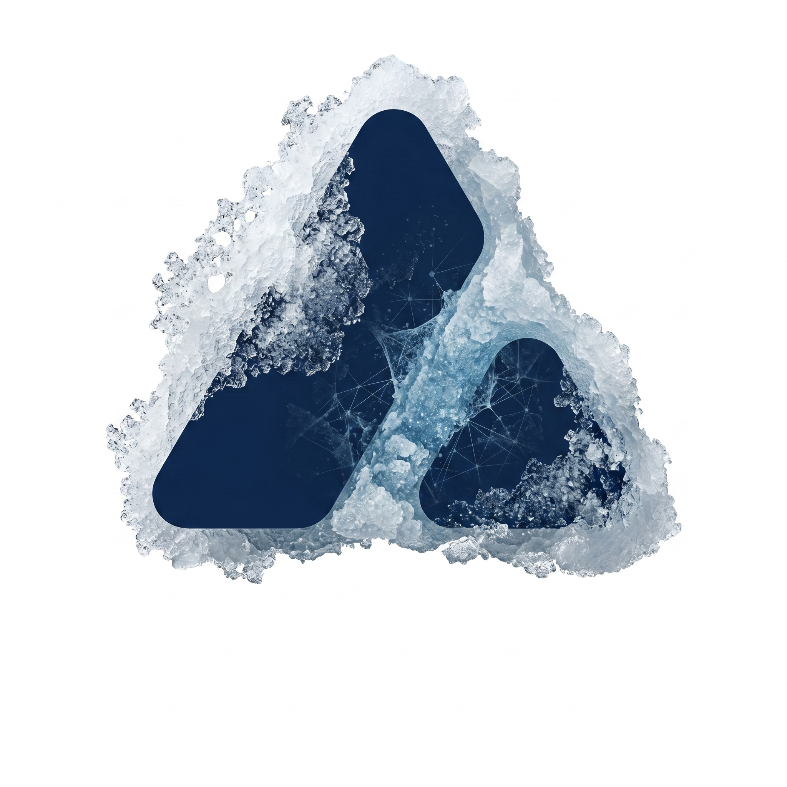

<p align="center">
  
</p>

# firn-explorer

> Reference frontend for [firn](https://github.com/ava-labs/firn). Self-hosted block explorer for any Avalanche L1.

A Next.js + React + TypeScript web app that consumes firn's `/v1/explorer/{bootstrap,feed}` endpoints. Single round-trip first paint, SSE-driven live updates with explicit per-tick deltas — no client-side merge buffer, no shift detection, no polling.

## Architecture

```
   firn API                          firn-explorer (this repo)
   (any AvalancheGo node)
                                     ┌──────────────────────────┐
   GET /v1/explorer/bootstrap  ─────► │ useExplorerBootstrap()   │
   (chain, stats, blocks, txs,        │  single-fetch first paint│
    icm, tps[50])                    └────────────┬─────────────┘
                                                  │
                                                  ▼ tanstack-query cache
                                     ┌──────────────────────────┐
   GET /v1/explorer/feed (SSE) ────► │ <ExplorerFeedBridge />   │
   tick events: shift, blocks[],      │  merges deltas into      │
   txs[], icm[], tpsPoint,            │  bootstrap cache slot    │
   statsDelta, removedTxs            └────────────┬─────────────┘
                                                  │
                                                  ▼
                                     pages: blocks · transactions ·
                                     icm · tokens · validators ·
                                     address · search · api playground
```

The explorer is one consumer of firn's API. The same endpoints are open for any other UI.

## Quick start

```bash
git clone https://github.com/ava-labs/firn-explorer
cd firn-explorer
pnpm install
```

Point at a running firn instance via `.env.local`:

```bash
# .env.local
NEXT_PUBLIC_FIRN_LOCAL=http://localhost:4000
NEXT_PUBLIC_FIRN_TESTNET=https://your-firn-testnet.example.com
NEXT_PUBLIC_FIRN_MAINNET=https://your-firn-mainnet.example.com
```

Networks are swappable from the topbar; only `LOCAL` is required, the others are optional. Then:

```bash
pnpm dev
# → http://localhost:3000
```

Don't have a firn instance running? `go run github.com/ava-labs/firn/cmd/firn` brings one up against a synthetic in-memory store on `:4000`. Good enough for frontend dev.

## Pages

| Route | What it shows |
|---|---|
| `/` | Hero stats + live blocks ticker + TPS sparkline + recent txns + ICM lane |
| `/blocks` | Paginated block list with filters (validator, range, has-txns) and sortable columns |
| `/blocks/[id]` | Block detail with tx list, ICM events, consensus tab |
| `/transactions` | Paginated tx list with filters (address, method selector, status) |
| `/transactions/[hash]` | Tx detail with logs, traces, status |
| `/icm` | Cross-chain (Warp + Teleporter) message stream with kind/emitter/messageId filters |
| `/tokens`, `/tokens/[hash]` | ERC-20 list + per-token detail (transfers, holders) |
| `/validators`, `/validators/[nodeID]` | P-Chain + L1 validator set, uptime, ACP-77 details |
| `/address/[hash]` | EOA / contract overview, txns, internal txns, token transfers, logs, code |
| `/api` | Live API playground over the v1 surface |
| `/search?q=…` | Hash / address / block / token symbol search |

Every list page has a Pause button so you can read a row without it scrolling away.

## Stack

- Next.js 16 (App Router) + React 19 + TypeScript
- TanStack Query for server state
- `motion` (Framer Motion) for the live sparkline + row entry animations
- Tailwind v4 + a small custom design system under `components/lattice/`
- SSE (`EventSource`) for the live feed; no WebSocket on the client side after the v1 cutover

## Deploy

Standard Next.js. Build:

```bash
pnpm build && pnpm start
```

Vercel, Cloudflare Pages, self-hosted Node, or behind nginx with `pnpm start` — pick whichever. The only runtime requirement is that `NEXT_PUBLIC_FIRN_*` URLs are reachable from the browser; they're baked into the bundle at build time, so set them on the build environment.

## License

Apache-2.0. Upstream deps: Next.js (MIT), React (MIT), TanStack Query (MIT), motion (MIT).
